# Samay backend

Self-hosted Supabase stack (Postgres 17 + GoTrue + PostgREST + Realtime +
Storage + Kong) plus a Go admin CLI/API (`github.com/samay-app/samay`). The Go
layer never touches Postgres — it uses PostgREST via Kong with the
`service_role` key.

## Make

- `make init` → `make start` — dev/testing (local Docker stack, `543xx`); `make tunnel` to expose it.
- `make init APP=samay ENV=staging|prod` — reconcile the env vault profile (Reuse/Re-generate) + clone its VM; then `make start APP=samay ENV=staging|prod`.
- `make start APP=samay ENV=staging|prod` · `make deploy APP=samay ENV=staging|prod` — VM + vault (Admin-only, vault passphrase).
- `make start APP=samay ENV=testing-local` — local Docker; `ENV=testing` adds the free Cloudflare tunnel (`TUNNEL=named` needs `CLOUDFLARE_TUNNEL_TOKEN`; `TUNNEL=quick` gives a random trycloudflare URL).
- `make test` · `make test db` (pgTAP) · `make test api` (curl) · `make check` · `make secrets|migrate|hooks`.
- `make build-cli|build-linux|build-api|build-loadtest` · `make loadtest [smoke]`.

## Testing config

The testing feed comes from the single **`supabase/.env`** (one `.env` per
project; `supabase/.env.example` is the committed template, bootstrapped by
`make init`). The **only** testing-time vault fetches are opt-in on the
CLI/shell, honored by `start` **and** `reset`:

- `FCM=true` → `tools/<fetch-fcm-secret>.sh` (the push worker's FCM key).
- `RC=true` → `tools/<fetch-rc-secret>.sh` (RevenueCat server secrets; `RC_ENV` selects
  `testing` (default) or `staging`).

There is no other edge case. `make start APP=samay ENV=staging|prod` is vault-gated
(everything from the vault); testing is not.

## Docs

`<private-ops-repo>/SELFHOSTING.md` (compose stack) · `BACKEND.md` (Go surface) ·
`DATABASE.md` (schema) · `BACKEND-SERVER-VM.md` (VM) · `DEPLOYMENT-PLACEHOLDER.md`.

## Architecture

## Deployment

